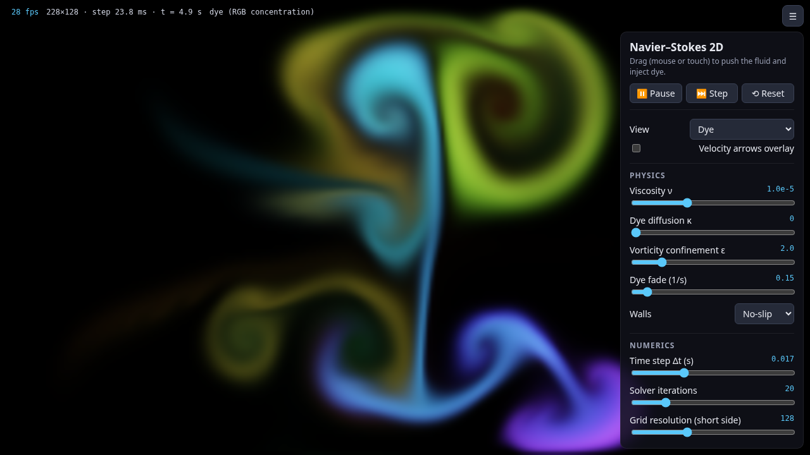
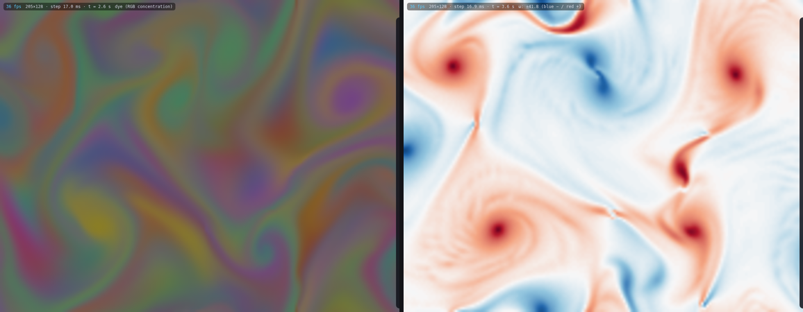
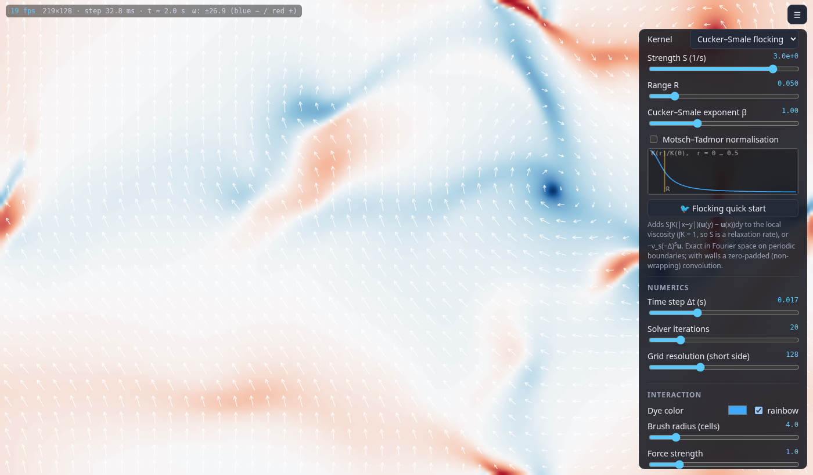
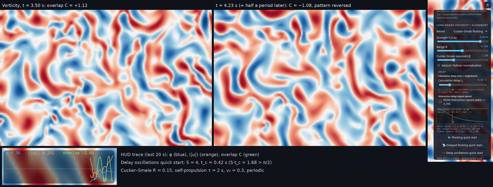
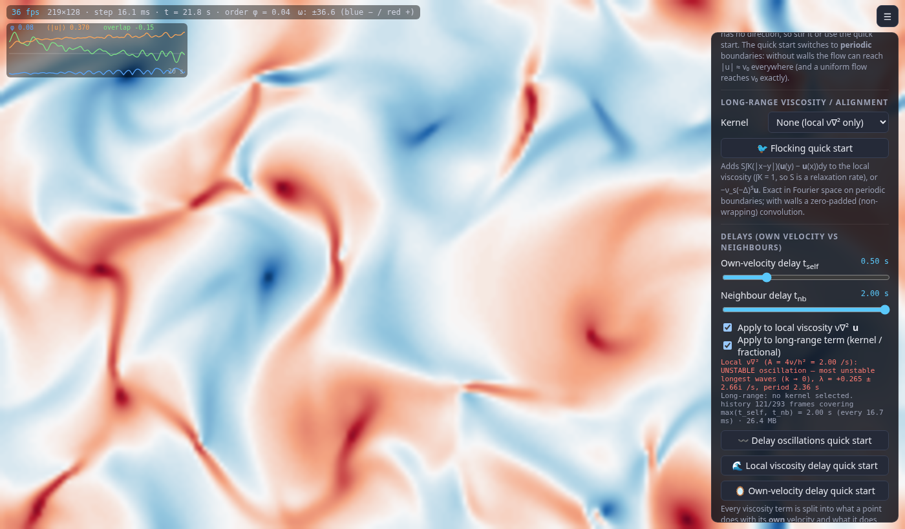
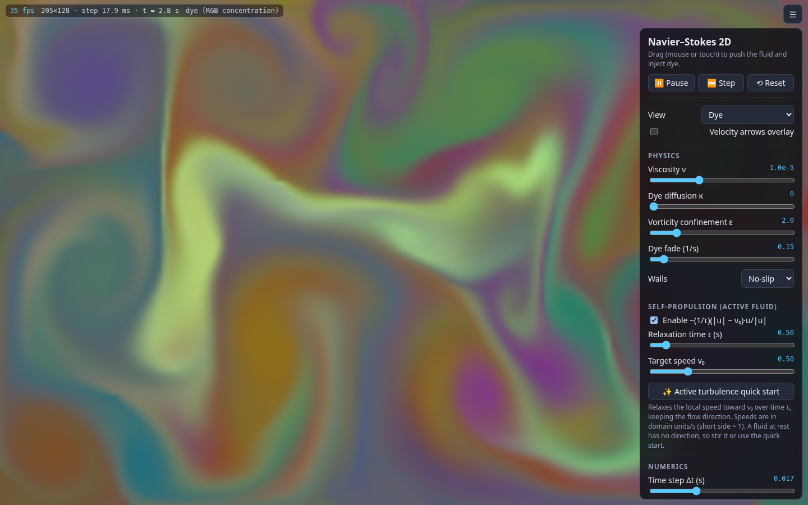
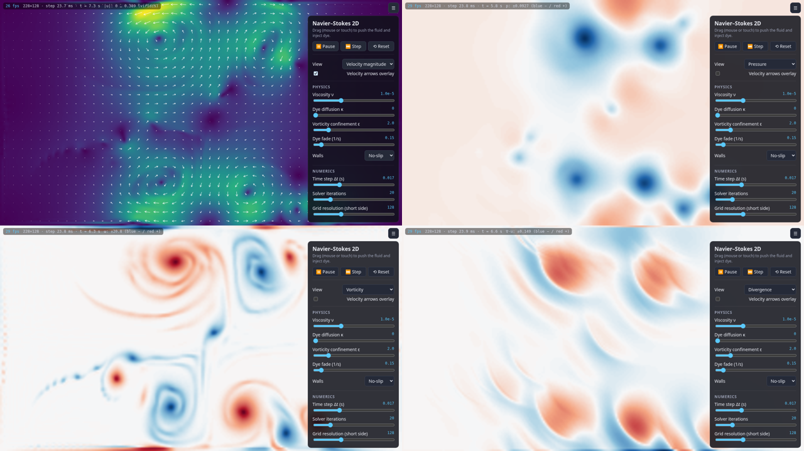

# Navier–Stokes 2D — interactive fluid simulator

A browser-based simulator for the **2D incompressible Navier–Stokes equations**
with a real-time visualization frontend. Drag with the mouse (or a finger) to
stir the fluid and inject coloured dye, and switch between views of the dye,
velocity, pressure, vorticity, and divergence fields. Boundaries can be solid
walls (no-slip or free-slip), fully **periodic**, or periodic in x with walls in
y (a channel). An optional **self-propulsion (active fluid)** term turns it
into a model of active turbulence, and long-range alignment kernels turn it
into a flock. Two **delays**, one for the point's own velocity (t_self) and one
for its neighbours' (t_nb), can be applied to the local and the long-range
viscosity: the alignment then over-corrects and the flow oscillates, with a live
stability analysis of every term.

**Try it live: <https://csviragh.github.io/navier-stokes-sim/>**



Built with **Vite + TypeScript** and no UI framework. The physics solver is a
standalone, DOM-free module with unit tests, so you can extend it (other
solvers, 3D, GPU) without touching the UI.

## The equations

For a fluid with constant density ρ (we use ρ = 1), velocity **u**(x, t) and
pressure p(x, t):

```
∂u/∂t + (u·∇)u = −∇p/ρ + ν∇²u + f − (1/τ)(|u| − v₀) u/|u|    (momentum)
∇·u = 0                                                       (incompressibility / mass)
```

(the last momentum term is optional and off by default, see
[Self-propulsion](#self-propulsion-active-fluid) below)

- **Momentum:** a fluid parcel accelerates because of pressure differences,
  viscous friction (kinematic viscosity ν), and external forces **f** (your
  mouse).
- **Incompressibility:** the velocity field is divergence-free, so no fluid is
  created or destroyed anywhere. Pressure is not given by an equation of state.
  It is whatever field keeps ∇·u = 0, i.e. a Lagrange multiplier.

### Self-propulsion (active fluid)

With **Self-propulsion** switched on, the momentum equation gets the extra
force per unit mass

```
f_active = −(1/τ) (|u| − v₀) · u/|u|
```

- **τ** (relaxation time, s) sets how quickly the local speed adapts;
- **v₀** (target speed, domain units/s, the short side of the box is 1) is the
  speed the fluid "wants" to move at;
- **u/|u|** is the local unit vector of the flow, so the term only changes the
  *speed*, never the *direction*.

Where the fluid is slower than v₀ (|u| < v₀) the term accelerates it, and where
it is faster (|u| > v₀) it brakes it. This is the self-propulsion term of
Toner–Tu / Vicsek-type models of active matter (swimming bacteria, flocks).

The term was requested as `1/tau(v(x)-v_0)*(v(x,t)/v(x,t))`, which we read as
`(1/τ)(|v| − v₀) v/|v|`, i.e. the second `v(x,t)` is the magnitude |v| and
the fraction is the unit vector. Written on the right-hand side of the momentum
equation as a force it carries a **minus sign**; that minus is what makes it a
*relaxation* toward v₀ (with a plus sign speeds away from v₀ would grow
exponentially). If you prefer to read the user's expression as the term moved to
the left-hand side, `∂u/∂t + … + (1/τ)(|u| − v₀) u/|u| = …`, it is the same
equation.

**Numerics.** On its own the term gives d|u|/dt = −(|u| − v₀)/τ along a fixed
direction, which is solved exactly over each step:

```
|u|_new = v₀ + (|u| − v₀) · exp(−Δt/τ),     u_new = |u|_new · u/|u|
```

This is unconditionally stable for any Δt/τ and never overshoots v₀. On the
MAC grid |u| is evaluated at each face (the other component is interpolated
from the four neighbouring faces, as in advection). Where |u| < 10⁻⁶ the
direction is undefined and the face is left unchanged, so fluid at rest stays
at rest. Stir it, or use **Active turbulence quick start** (key `T`), which
seeds weak random swirls that the term then amplifies.

The step runs after advection and **before** the final projection, so the
field stays divergence-free. Because a uniform speed is generally not
compatible with ∇·u = 0 and the walls, |u| does **not** end up exactly v₀
everywhere. In a 64² box with v₀ = 0.5 and τ = 0.25 s the mean speed settles
at about 0.43 (≈ 87 % of v₀), with vortices and jets: active turbulence.

With **periodic** boundaries there are no walls to brake the flow. A uniform
flow is divergence free and periodic, so it is driven to |u| = v₀ *exactly*
(this is a unit test). Starting from random swirls on the torus (228 × 128,
v₀ = 0.5, τ = 0.5 s, ε = 2) the mean speed reaches ≈ 0.466 after 20 s (≈ 93 %
of v₀), versus ≈ 0.454 with no-slip walls and ≈ 0.459 in the periodic-x channel
under the same settings. The **Active
turbulence quick start** therefore switches the boundaries to periodic (you can
switch back at any time).



The dye is a passive scalar c (one per RGB channel) that is carried by the flow
and optionally diffuses (κ) and fades:

```
∂c/∂t + (u·∇)c = κ∇²c
```

### Long-range viscosity / alignment kernels

The local viscous term ν∇²u only couples neighbouring points. The
**Long-range viscosity / alignment** section adds an optional *nonlocal* term
**on top of** the local ν∇²u (the ν slider is unchanged; kernel *None* is the
default and leaves the solver bit-identical to before):

```
f_K(x) = S ∫ K(|x − y|) (u(y) − u(x)) dy          (convolution kernels, ∫K dA = 1)
f_s    = −ν_s (−Δ)^s u                            (fractional Laplacian, 0 < s ≤ 1)
```

| Kernel | K(r) before normalisation | Parameters |
|---|---|---|
| Gaussian | exp(−r²/(2R²)) | S, R |
| Cucker–Smale flocking | (1 + r²/R²)^(−β) | S, R, β (optional Motsch–Tadmor normalisation) |
| Power law | (r² + R²)^(−α/2) (R = softening length) | S, R, α |
| Fractional Laplacian | Fourier symbol ν_s λ(k)^s, λ = discrete −Δ symbol | ν_s, s |

**Normalisation.** Every convolution kernel is normalised so that ∫K dA = 1
(discretely Σ K h² = 1 over every offset that fits in the domain). S is then a
**rate** (1/s): each point relaxes toward its K-weighted neighbourhood average
velocity at rate S. For a Gaussian with small R, `S∫K(u(y) − u(x))dy ≈ S(R²/2)∇²u`,
so it is ordinary viscosity with ν_eff = S R²/2 (checked by a test). The
fractional strength ν_s has units L^{2s}/s, and s = 1 gives exactly the local
viscous decay rate νλ(k).

**Motsch–Tadmor** (checkbox): divide by the local kernel mass
c(x) = ∫_domain K(|x − y|) dy instead of ∫K = 1. With a uniform density, this
only makes a difference next to walls, where part of the kernel lies outside
the domain. On periodic grids it does nothing.

**How it is computed** (each velocity component on its own staggered sub-grid:
u on u-faces, v on v-faces, unknown faces only; the projection afterwards
restores ∇·u = 0). This is step 2b, right after local diffusion:

- *Fully periodic:* 2D FFT of exactly the grid size (radix-2 or Bluestein for
  any length), with minimum-image distances. The operator is diagonal:
  λ(k) = S(K̂(k) − K̂(0)) ≤ 0, applied **exactly** as û ← û·e^{λΔt}. The fractional
  term uses û ← û·e^{−ν_s λ(k)^s Δt}. Momentum is conserved exactly (λ(0) = 0) and
  kinetic energy can never increase.
- *Walls on at least one axis* (no-slip, free-slip, periodic-x channel): the
  walled axes are zero-padded to a power of two ≥ 2n − 1, so the convolution is
  **linear and never wraps across a wall**. The integral runs over the domain
  only: `f = S[(K*u)(x) − c(x)u(x)]` with c = K * 1_domain. Integration is
  semi-implicit, `u ← (u + SΔt (K*u)) / (1 + SΔt c)`: the convolution is
  explicit and the local part implicit. The result is a convex combination of
  old values, so it obeys a max principle and is stable for any Δt. Walls are
  not treated as zero-velocity neighbours; the kernel only aligns fluid with
  fluid.
- *Fractional on walled domains* is **not implemented**. It is inactive there,
  and the panel says so.

Kernel transforms are precomputed and cached. They are rebuilt only when the
kernel, R, β, α, s, boundaries, or grid change.

**With self-propulsion**, the kernel turns active turbulence into a
**flock**. Self-propulsion fixes the speed |u| ≈ v₀, and the alignment kernel
makes the directions agree over distance R. This is a continuum
Toner–Tu / Cucker–Smale-like active fluid. On a torus with Cucker–Smale
(S = 3/s, R = 0.05, β = 1), weak random swirls order into a global flow with
mean velocity ≈ v₀ within a few seconds. Try **🐦 Flocking quick start** (`F`).

References: F. Cucker & S. Smale, "Emergent behavior in flocks", *IEEE Trans.
Automatic Control* 52 (2007) 852–862; S. Motsch & E. Tadmor, "A new model for
self-organized dynamics and its flocking behavior", *J. Stat. Phys.* 144 (2011)
923–947; J. Toner & Y. Tu, *PRL* 75 (1995) 4326; M. Kwaśnicki, "Ten equivalent
definitions of the fractional Laplace operator", *Fract. Calc. Appl. Anal.* 20
(2017); and on alignment with nonlocal viscosity, E. Tadmor & C. Tan, *Phil.
Trans. R. Soc. A* 372 (2014).



### Delays: own velocity vs neighbours

Real agents (birds, robots, cells) react to what they *sensed*, and that
information is old: it took time to measure, transmit and process it. The
simulator models this with **two constant delays**, applied to every
viscosity-like term:

- **t_self** (*Own-velocity delay*, 0–2 s, default 0) is how old the point's
  knowledge of its **own** velocity is.
- **t_nb** (*Neighbour delay*, 0–2 s, default 0) is how old the velocities of
  its **neighbours** are.

Every viscosity term can be split exactly into "what the neighbours do" minus
"what I do", and each part gets its own delay:

```
local viscosity:   ν/h² [ Σ_nb u(x+e, t − t_nb) − 4 u(x, t − t_self) ]        (5-point stencil, per boundary)
long-range kernel: S [ (K * u)(x, t − t_nb) − c u(x, t − t_self) ]           (c = 1 normalised, c = ∫K Motsch–Tadmor)
fractional:        −ν_s [ G₀ u(t − t_self) − (G₀ − (−Δ)^s) u(t − t_nb) ]    (G₀ = mean of the symbol λ^s, torus only)
```

With t_self = t_nb = 0 these are the ordinary terms. The local split uses the
same stencil as the implicit diffusion for each boundary type (wall faces and
ghost reflections for no-slip/free-slip, wrap-around on periodic axes), so it is
exact on every boundary. For the fractional Laplacian there is no finite
stencil, but there is a clean split: its diagonal (the self-weight of the
operator) is G₀ = ⟨λ^s⟩ over all grid modes, the rest is the neighbour part. For
s = 1 this reproduces the delayed local term (tested to 1e-5). Dye diffusion is
not delayed: it is a passive scalar, not something the agents compute.

**Design: one shared pair of delays, per-term switches.** The two sliders apply
to every term, with two check boxes (*Apply to local viscosity ν∇²u*, *Apply to
long-range term*, both on by default) to take a term out. A delay is a property
of the agent (how stale its sensors and its own state estimate are), not of a
particular force, so one pair is the honest model and keeps the combined
characteristic equation a two-delay one. Per-term switches still allow the
textbook experiments (only the kernel delayed, as in the delayed Cucker–Smale
papers, or only the local viscosity).

The finite interaction speed (v_int, distance-dependent delays and delay
shells) from earlier versions is gone. The neighbour delay t_nb is a constant,
so it is a single convolution of one past field.

**Stability analysis.** For one Fourier mode every delayed term has the form

```
x'(t) = −A x(t − t_self) + B x(t − t_nb)
λ + A e^{−λ t_self} − B e^{−λ t_nb} = 0           (characteristic equation, Bellman & Cooke 1963)
local:      A = 4ν/h²,  B = A c,   c = (cos k_x h + cos k_y h)/2 ∈ [−1, 1]
kernel:     A = S,      B = S K̂(k)
fractional: A = ν_s G₀, B = ν_s (G₀ − λ^s)
```

The mode grows if the rightmost root has Re λ > 0. Two special cases are exact:

- t_self = t_nb = τ: λ = −(A − B) e^{−λτ}, so λ = W₀(−(A − B)τ)/τ (Lambert W,
  principal branch). Monotone decay for (A − B)τ ≤ 1/e, damped oscillation up to
  π/2, growing oscillation with period ≈ 4τ beyond. This reproduces the old
  "calculation delay" t_c exactly (bit-identical on walled domains, ≤ 2e-7 on
  the torus).
- t_self = 0: x' = −A x + B x(t − t_nb). Hayes (1950): stable for every t_nb
  when |B| ≤ A. That always holds here (|c| ≤ 1, |K̂| ≤ 1), so delaying only the
  neighbours can never destabilise anything; the checkerboard (B = −A) is
  marginal, with roots that approach the imaginary axis but never cross it. The
  solver treats this case semi-implicitly, (u + a w)/(1 + a c), which also gives a
  discrete maximum principle.

Otherwise the solver finds the rightmost root numerically (Newton from a grid of
starting points plus a bracketed real-root search, `src/solver/stability.ts`)
for a scan of 41 values of B/A over the range present on the current grid, and
shows the worst one live for each term: regime (monotone, damped, unstable
oscillation, unstable real), the most unstable mode, λ and the period. The scan
shows that the most unstable mode is **always one of the two ends** of the
range: the longest waves (c, K̂ → 1) or the shortest (checkerboard c = −1,
K̂ ≈ 0), never an intermediate wavelength. In units of A:

| case | what goes unstable |
| --- | --- |
| t_self = 0, any t_nb | nothing (Hayes), checkerboard marginal |
| t_self = t_nb = τ | shortest waves first: local checkerboard at 2Aτ = π/2, i.e. 8ντ/h² = π/2; kernel K̂ ≈ 0 at Sτ = π/2 |
| t_self > t_nb + 1/A (roughly) | longest waves, **real** runaway: λ = A(1 − e^{−λ t_self}) + … has a positive real root. The point brakes against where it was while following where its neighbours are |
| 0 < t_self < t_nb | the neighbour delay can destabilise the checkerboard, e.g. A t_self = 0.6, A t_nb ≥ 1.4 |
| t_nb ≫ t_self | long waves oscillate unstably, e.g. A t_self = 1, A t_nb = 4: long waves 0.132 ± 1.33 i, checkerboard 0.068 ± 0.75 i (units of A) |

**The checkerboard.** For the local term with equal delays, the checkerboard
mode (u alternating sign from cell to cell) has the largest A − B = 2A = 8ν/h²
and goes unstable first. The continuum delayed heat equation is ill-posed for
any t_self = t_nb > 0 (A − B ∝ k² has no upper bound), so in the simulator the
only cut-off is the grid, and the onset depends on h: refining the grid at fixed
ν and τ makes it unstable. In the full solver without self-propulsion a
delayed-local run with 8ντ/h² > π/2 grows grid-scale noise into a checkerboard
(grid-noise measure 0.001 → 1.8 in 10 s). With self-propulsion (v₀ = 0.3) the
moving fluid is advected semi-Lagrangian, whose bilinear interpolation damps
grid-scale modes strongly, and the checkerboard stays suppressed (measure
≈ 0.002). The panel warns when the checkerboard is the most unstable mode.

**Numerics vs. theory** (full solver, single shear-wave or Fourier mode,
ν = 0 except where the local term is tested, growth rate and frequency fitted
from peaks and zero crossings):

| term | t_self | t_nb | predicted λ (1/s) | simulated μ, ω |
| --- | --- | --- | --- | --- |
| kernel CS R = 0.15, S = 4, m = 4 (K̂ = 0.007) | 0.3 | 0.3 | −0.652 ± 4.784 i | −0.653, 4.783 |
| ″ | 0.38 | 0.38 | −0.075 ± 4.085 i | −0.076, 4.085 |
| ″ | 0.41 | 0.41 | +0.062 ± 3.870 i | +0.062, 3.870 |
| ″ | 0.45 | 0.2 | +0.214 ± 3.609 i | +0.214, 3.608 |
| ″ | 0.3 | 0.8 | −0.629 ± 4.826 i | −0.630, 4.825 |
| ″ | 0.5 | 0.1 | +0.349 ± 3.334 i | +0.349, 3.334 |
| kernel Gaussian R = 0.05, S = 4, m = 4 (K̂ = 0.454) | 0.3 | 0.6 | −0.686 ± 6.289 i | −0.667, 6.231 |
| ″ | 0.45 | 0.2 | +0.109 ± 2.637 i | +0.108, 2.637 |
| ″ | 0.7 | 0.3 | +0.534 ± 1.830 i | +0.534, 1.830 |
| kernel Gaussian, m = 1 (K̂ = 0.952) | 0.42 | 0 | +2.258 (real) | +2.249 |
| local A = 8/s, m = 6 (c = 0.5) | 0.3 | 0.3 | −0.635 ± 4.797 i | −0.636, 4.796 |
| ″ | 0.1 | 0.3 | −1.397 ± 15.198 i | −1.402, 15.286 |
| ″ | 0.22 | 0.15 | −0.600 ± 5.249 i | −0.601, 5.249 |
| local A = 8/s, m = 12 (c = 0) | 0.2 | 0.2 | +0.066 ± 7.896 i | +0.060, 7.892 |
| local A = 8/s, m = 1 | 0.3 | 0.1 | +2.137 (real) | +2.158 |
| local A = 2/s, m = 4 (c = 0.75) | 0.5 | 2 | +0.170 ± 2.660 i | +0.178, 2.640 |
| local checkerboard A = 4/s | 0.3 | 0.3 | +1.015 ± 5.812 i | +1.007, 5.819 |
| ″ | 0.15 | 0.5 | +0.112 ± 4.974 i | +0.111, 4.973 |
| ″ | 0 | 0.3 | −1.747 ± 6.369 i | −1.796, 6.295 (decays to 1e-8) |

**Momentum.** On the torus the mean flow M obeys dM/dt = −A[M(t − t_self) −
M(t − t_nb)], so M itself is not conserved when the delays differ, but
Q = M + A ∫_{t−t_nb}^{t−t_self} M ds is (tested). With t_self > t_nb + 1/A the
mean flow is itself in the real-runaway regime and a uniform drift can grow.

**What you see.**

- **〰️ Delay oscillations** (`O`): Cucker–Smale (R = 0.15, β = 1), S = 4/s,
  t_self = t_nb = 0.42 s (S·τ = 1.68 > π/2), kernel only, weak self-propulsion
  (τ = 2 s, v₀ = 0.3), periodic, no vorticity confinement, vorticity view, weak
  random start. Predicted λ = +0.115 ± 3.81 i (period 1.65 s): the whole vortex
  pattern reverses every half period (red and blue swap) and the HUD overlap
  C(t) = ⟨u·u₀⟩/⟨u₀·u₀⟩ with the starting flow swings between ±1 (headless
  browser: sign changes every ≈ 0.85 s, |C| up to 1.2, ⟨|u|⟩ 0.04 → 0.32 in
  9 s, no NaN). Same physics as the old calculation-delay quick start.

  
- **🌊 Local viscosity delay** (`L`): no kernel, only ν∇² delayed with
  t_self = 0.5 s, t_nb = 2 s, ν set from the grid so that A = 4ν/h² = 2/s,
  self-propulsion τ = 0.2 s, v₀ = 0.3, periodic. The longest waves oscillate
  unstably, λ = +0.265 ± 2.66 i (period 2.36 s); the overlap trace oscillates with
  a period of about 2.3–2.4 s while self-propulsion keeps the speed bounded
  (⟨|u|⟩ ≈ 0.32–0.37 in the browser).
- **🪞 Own-velocity delay** (`N`): the `O` setup with t_self = 0.42 s, t_nb = 0 and
  fast self-propulsion (τ = 0.1 s). The long waves run away (real root): the
  fluid locks into a single aligned flock within about 6 s (φ = 1.00) whose
  heading rotates steadily at ω ≈ 4 rad/s (ω = S sin(ω t_self), a period of
  ≈ 1.6 s), with ⟨|u|⟩ ≈ 0.47 > v₀. With slow self-propulsion (τ = 2 s) it runs
  into the speed guard instead. Swap the sliders (t_self = 0, t_nb = 0.42) and
  the same flow is stable.



**Numerics of the delayed terms.** A delayed own velocity cannot be implicit, so
with any delay the affected terms leave the implicit/Fourier path and use an
explicit update with the delayed fields read at the step midpoint (second
order):

```
u ← u + Δt·S [ (K * u)(t + Δt/2 − t_nb) − c·u(t + Δt/2 − t_self) ]          (kernel; Motsch–Tadmor a = SΔt/c)
u ← u + Δt_s·ν/h² [ Σ_nb u(t_m − t_nb) − 4 u(t_m − t_self) ]   per sub-step (local)
```

- Reads later than the current time use the evolving field, so 0 < τ < Δt blends
  continuously into explicit Euler (tested).
- The local explicit update needs νΔt/h² ≲ 1/4; the solver sub-steps it to keep
  νΔt_s/h² ≤ 0.2 (up to 32 sub-steps, the panel shows the count and warns if the
  cap is hit). The kernel term warns when S·Δt > 1.
- t_self = 0 with t_nb > 0 is semi-implicit (above). Because exactly 0 switches
  scheme, there is an O(Δt) jump between t_self = 0 and a tiny t_self > 0.
- History: full u and v fields in a ring buffer (Float32), one frame per step
  up to 512 frames, linear interpolation in time, covering max(t_self, t_nb).
  Total memory is capped at 64 MB; a large grid with a long delay coarsens the
  frame interval instead. Until enough history exists the oldest frame is used.
  Reset, grid and boundary changes, and setting both delays to 0 clear it.
- A speed guard clamps each face velocity to ±10 after the delayed update.
- With both delays 0 the old code runs unchanged, bit for bit (implicit
  diffusion, exact Fourier kernel on the torus).

References:

- N. D. Hayes, "Roots of the transcendental equation associated with a certain
  difference-differential equation", *J. London Math. Soc.* 25 (1950) 226–232.
- R. Bellman & K. L. Cooke, *Differential-Difference Equations*, Academic Press
  (1963).
- R. Erban, J. Haškovec & Y. Sun, "A Cucker–Smale model with noise and delay",
  *SIAM J. Appl. Math.* 76 (2016) 1535–1557.
- C. Pignotti & E. Trélat, "Convergence to consensus of the general finite-
  dimensional Cucker–Smale model with time-varying delays", *Commun. Math. Sci.*
  16 (2018) 2053–2076.
- C. Virágh et al., "Flocking algorithm for autonomous flying robots",
  *Bioinspir. Biomim.* 9 (2014) 025012 (sensor and communication delays and the
  oscillations they cause in robot flocks).


## Numerical method

The solver follows Jos Stam's **Stable Fluids** (SIGGRAPH 1999; "Real-Time Fluid
Dynamics for Games", GDC 2003) with operator splitting. Each time step Δt runs:

1. **Forces.** User strokes blend the velocity under a Gaussian brush toward the
   pointer velocity. Optional **vorticity confinement** (Fedkiw, Stam & Jensen
   2001) adds `f = ε h (N × ω)` with `N = ∇|ω| / |∇|ω||` to restore small swirls
   that numerical dissipation removes.
2. **Viscous diffusion**, implicitly (backward Euler): `(I − νΔt∇²) u = u*`,
   solved with Gauss–Seidel. This is unconditionally stable. The sweep count
   adapts to how stiff the system is, capped by the *solver iterations* setting.
3. **Projection.** Solve the pressure Poisson equation `∇²p = (ρ/Δt) ∇·u*` with
   `∂p/∂n = 0` on the walls, using Gauss–Seidel with successive over-relaxation
   (SOR, ω = 1.7, warm-started from the previous step's pressure). With
   periodic boundaries it is solved directly with FFTs instead (see
   *Boundaries*). Then set
   `u = u* − (Δt/ρ) ∇p`. This is the Helmholtz–Hodge decomposition, which keeps
   only the divergence-free part.
4. **Self-advection**, semi-Lagrangian: trace each velocity sample backward
   through the flow (2nd-order Runge–Kutta), then **bilinearly interpolate** the
   old field there. Results are convex combinations of old values, so this step
   is unconditionally stable too.
5. **Self-propulsion** (optional): exact relaxation of the local speed toward v₀,
   `|u| ← v₀ + (|u| − v₀) e^(−Δt/τ)` along u/|u| (see above).
6. **Projection** again.

   (Step 2b, between local diffusion and the first projection, applies the
   optional long-range kernel; see above.)
7. **Dye:** implicit diffusion, semi-Lagrangian advection, and optional
   exponential fade.

**Grid.** The grid is a uniform staggered **MAC** grid. Pressure and dye sit at
cell centres, u on vertical faces, and v on horizontal faces. The discrete
divergence, gradient, and Laplacian are mutually consistent, so the projection
drives the discrete divergence to zero, up to solver tolerance. It also avoids
the checkerboard pressure modes of a collocated grid. The shorter side of the
domain has length 1. The default grid has **128 cells on the short side**, and
the long side follows the window's aspect ratio (e.g. 228 × 128 on a 16:9
window).

**Boundaries.** Choose them in the *Boundaries* menu (key `B` cycles):

| option | x edges | y edges |
|---|---|---|
| **No-slip walls** (default) | solid, u = 0 | solid, u = 0 |
| **Free-slip walls** | solid, no normal flow, tangential slides | same |
| **Periodic (torus)** | periodic | periodic |
| **Periodic in x, walls in y** | periodic | no-slip walls (endless channel) |

At solid walls the normal velocity is zero, and dye and pressure use zero-flux
(Neumann) conditions. On a **periodic** axis the domain wraps around:

- *Staggered faces.* The u-face at i = 0 and the one at i = nx are the same
  physical face. Face nx holds the unknown, and face 0 is kept as an exact copy,
  so nothing is counted twice. Likewise v at j = 0 ≡ j = ny. Ghost cells/rows hold
  wrapped copies of the opposite edge.
- *Viscosity and dye diffusion.* The 5-point Gauss–Seidel stencils read their
  neighbours across the seam directly from the opposite edge.
- *Pressure.* The Poisson equation uses the periodic Laplacian (every cell has
  4 neighbours along a periodic axis). It is singular (p is only defined up to a
  constant), so the mean of the right-hand side is removed (it is zero up to
  round-off, because the divergence telescopes) and the mean of p is pinned to 0.
  With a periodic axis the solve is **direct** and exact. An FFT along x
  diagonalises the Laplacian. For each x-wavenumber the remaining problem in y
  is a cyclic tridiagonal system on the torus (Thomas + Sherman–Morrison) or a
  Neumann tridiagonal system in the channel (Thomas). Bluestein's algorithm
  handles any grid width. So ∇·u is at round-off level after every projection,
  in every cell including the seam cells, and the *solver iterations* setting
  only affects the viscosity and dye-diffusion sweeps there. (A wrap-around SOR
  is kept as a reference. With a fixed sweep origin and only ~20 sweeps its
  residual piles up next to the seam, which is why it isn't the default.)
- *Gradient.* The pressure gradient is applied to the seam faces too.
- *Advection.* Semi-Lagrangian back-traces wrap around instead of being
  clamped, and the bilinear interpolation reads the wrapped ghosts. This applies
  to the velocity and the dye.
- *Self-propulsion, vorticity confinement, diagnostics.* Face-to-face
  interpolation, |ω| gradients, and the vorticity/divergence/arrow views use the
  wrapped neighbours. Mouse strokes near an edge continue on the opposite side.
- Switching the boundary at runtime makes the edge faces walls (zeroed) or seam
  unknowns as needed, and re-projects the velocity.

With periodic boundaries the total momentum can only change through your
strokes, since viscosity and projection conserve it to round-off. Semi-Lagrangian
advection is not exactly conservative, so a strongly stirred field slowly loses
a little (∝ amplitude²). A uniform flow and a uniform dye stay exactly uniform.

## Features

- Full-window Canvas2D rendering. The field is drawn at grid resolution and
  upscaled with bilinear smoothing.
- Mouse, touch, and pen input through Pointer Events, including multi-touch.
  Drag to inject velocity along the drag direction and to inject dye.
- **View modes:** dye, velocity magnitude (viridis), pressure, vorticity, and
  divergence. The last three use a diverging blue/white/red map with
  auto-scaling and an on-screen legend. A velocity-arrow overlay can be shown
  on top of any view.
- **Controls:** viscosity, dye diffusion, time step, solver iterations, grid
  resolution, vorticity strength, dye fade, boundaries (no-slip, free-slip,
  periodic, periodic-x channel), dye colour (or rainbow),
  brush radius, force strength, pause/play, single step, and reset.
- **Self-propulsion (active fluid)** section: on/off toggle (default off), τ
  (0.05–5 s, default 0.5 s), v₀ (0–2, default 0.5), and an *Active turbulence
  quick start* button that switches the term on, selects periodic boundaries,
  and seeds random weak flow.
- **Long-range viscosity / alignment** section: kernel (None, Gaussian,
  Cucker–Smale, power law, fractional; default None), strength (log slider,
  default S = 2/s), range R (0.005–0.3, default 0.05), β (default 1), α
  (default 3), s (default 0.5), Motsch–Tadmor checkbox, a live plot of K(r)
  (or of the fractional multiplier), and a *Flocking quick start* button that
  selects Cucker–Smale, self-propulsion, periodic boundaries, and turns off
  vorticity confinement.
- **Delays (own velocity vs neighbours)** section: own-velocity delay t_self
  and neighbour delay t_nb (0–2 s each, default 0), check boxes to apply them
  to the local viscosity and to the long-range term (both on by default), a
  live stability readout per term (regime, most unstable mode, rightmost root
  λ, period), the history line (frames, interval, memory) and warnings
  (local sub-steps, explicit limit, S·Δt > 1, checkerboard). Quick starts:
  *Delay oscillations* (`O`), *Local viscosity delay* (`L`), *Own-velocity
  delay* (`N`).
- **HUD time trace** (top left): φ, ⟨|u|⟩ and the overlap with the flow at the
  last reset / quick start, over the last 20 s of simulated time.
- FPS, grid size, solver time per step, and (with a kernel or self-propulsion)
  the polar order parameter φ are shown in the HUD. A short
  explanation of the equations is built into the panel.
- **Keyboard:** `Space` pause, `S` step, `R` reset, `V` cycle view, `A` toggle
  arrows, `B` cycle boundaries, `P` toggle self-propulsion, `T`
  active-turbulence quick start, `K` cycle kernel, `F` flocking quick start,
  `O` delay-oscillations quick start, `L` local-viscosity-delay quick start,
  `N` own-velocity-delay quick start, `H` hide the panel.





## Getting started

Requires Node.js ≥ 20.19 (CI uses Node 22).

```bash
npm install
npm run dev       # start the dev server (http://localhost:5173)
npm test          # run the solver unit tests (Vitest)
npm run build     # type-check and build static files into dist/
npm run preview   # serve the production build locally
```

## Project structure

```
src/
  solver/            # pure numerics, no DOM: unit-testable and portable
    grid.ts          #   MAC grid layout, indexing, field allocation,
                     #   boundary types (walls / periodic / periodic-x)
    ops.ts           #   kernels: boundaries, interpolation, diffusion,
                     #   advection, projection, vorticity confinement,
                     #   self-propulsion (active fluid)
    poisson.ts       #   direct periodic pressure solver (FFT + tridiagonal)
    fft.ts           #   radix-2 / Bluestein FFT for any length
    kernels.ts       #   nonlocal viscosity / alignment kernels (spectral),
                     #   explicit / semi-implicit delayed kernel update
    delay.ts         #   FieldHistory: ring buffer of past u, v fields
    stability.ts     #   rightmost root of λ + A e^{−λ t_self} − B e^{−λ t_nb}
    fluid.ts         #   FluidSolver: state + time stepping, splat/stir input
    index.ts
  render/
    colormaps.ts     # viridis / diverging lookup tables, colour helpers
    renderer.ts      # Canvas2D field rendering + velocity-arrow overlay
  ui/
    settings.ts      # user settings and defaults
    controls.ts      # binds the HTML control panel and keyboard shortcuts
    pointer.ts       # mouse / touch / pen input via Pointer Events
  main.ts            # wiring + animation loop
  style.css
tests/
  solver.test.ts     # Vitest unit tests for the solver
  selfprop.test.ts   # tests for the self-propulsion term
  periodic.test.ts   # tests for the periodic boundaries
  kernels.test.ts    # tests for the long-range viscosity / alignment kernels
  delays.test.ts     # tests for the own / neighbour delays (stability theory)
  lambert.ts         # Lambert W₀ for the delay characteristic equation
  fingerprint.ts     # bit-exact fingerprints of scripted runs
index.html           # page layout, control panel, equations panel
.github/workflows/
  ci.yml             # tests + build on push / PR
  deploy-pages.yml   # GitHub Pages deployment (on push to main)
```

The solver is plain TypeScript on `Float32Array`s. You can use it on its own:

```ts
import { FluidSolver } from './src/solver';

const sim = new FluidSolver(128, 128, { viscosity: 1e-4, iterations: 30 });
sim.splat(64, 32, 0, 2, [1, 0.5, 0.2], 6); // velocity impulse + dye
for (let n = 0; n < 100; n++) sim.step();
sim.updateDiagnostics(); // fills uc, vc, divergence, vorticity
```

## Tests

`tests/solver.test.ts` checks, among other things, that:

- projection reduces the RMS divergence by more than 1000× and leaves an
  already divergence-free field unchanged;
- dye mass is roughly conserved under advection in a closed box (within 10%
  after 120 steps; semi-Lagrangian advection is not exactly conservative), and
  conserved to within 1% under pure diffusion;
- uniform-velocity advection translates a field exactly and interpolates
  bilinearly;
- 500 steps of strong random forcing with vorticity confinement produce no
  NaNs and stay bounded;
- a zero field stays exactly zero;
- walls don't leak dye, viscosity dissipates energy, and the stir, reset, and
  resample helpers behave correctly.

`tests/kernels.test.ts` checks the nonlocal kernels. On periodic grids every
kernel conserves momentum, never increases energy, and leaves uniform flow
unchanged. A single Fourier mode decays at exactly S(K̂(0) − K̂(k)) for Gaussian
and Cucker–Smale, and the Gaussian matches its analytic transform. A small-R
Gaussian matches ν_eff = S R²/2. Fractional s = 1 reproduces the local viscous
rate, and s < 1 flattens the spectrum. The walled convolution doesn't wrap
across walls and obeys a max principle. Long runs with kernels, self-propulsion,
and stirring stay finite on all boundary types. With kernel None, all four
boundary types are bit-identical to commit 22fd8ba.

`tests/delays.test.ts` checks the own / neighbour delays (20 tests):

- *Theory:* the two-delay root finder reduces to Lambert W for equal delays and
  to B + W(−Aτe^{−Bτ})/τ for t_nb = 0; with t_self = 0 every |B| ≤ A is stable
  (Hayes); the local scan's worst mode is always an end of the range
  (checkerboard or longest wave).
- *Backward compatibility:* with both delays 0, all kernel and boundary
  fingerprints are bit-identical to commit 6c811e2 (flags on or off). With
  t_self = t_nb = t_c on the kernel, the old calculation-delay runs are
  reproduced bit for bit on walled domains and to ≤ 2e-7 on the torus, and the
  fitted growth rates and frequencies match the old ones to 1e-6.
- *Kernel:* shear-wave growth rate and frequency follow the characteristic
  equation for equal and unequal delays (CS, K̂ ≈ 0, and a narrow Gaussian,
  K̂ = 0.45); t_nb = 0 with S·t_self > 1 gives a non-oscillating long-wave
  runaway; t_self = 0 never grows (periodic and walls, Motsch–Tadmor on/off).
- *Local viscosity:* single Fourier modes match the theory in rate and
  frequency (decay, growth, real runaway, long-wave oscillation); the
  checkerboard goes unstable at the Lambert-W rate for equal delays, stays
  bounded for t_self = 0, and is destabilised by the neighbour delay alone for
  0 < t_self < t_nb; sub-steps keep νΔt/h² > 1/4 stable.
- *Invariants:* uniform flow unchanged; on the torus the delayed momentum
  invariant M + A∫_{t−t_nb}^{t−t_self} M ds is conserved; unstable runs with
  self-propulsion stay bounded and finite on every boundary (no NaN) and the
  speed guard holds without it; fractional s = 1 equals the delayed local term;
  t_self in (0, Δt] is continuous; the history covers max(t_self, t_nb), is
  capped in memory, is cleared by reset, boundary change and delays → 0, and
  runs are reproducible; the panel readouts identify the right modes.

`tests/selfprop.test.ts` checks the self-propulsion term:

- a uniform flow relaxes toward v₀ from below and from above, matching
  `v₀ + (|u|₀ − v₀) e^(−t/τ)`, and an oblique flow keeps its direction;
- the update is exact without overshoot even for Δt ≫ τ;
- a zero field stays exactly zero (no NaNs from u/|u|);
- 500 steps with the term on plus random stirring stay finite and bounded;
- weak random flow is driven up to an rms speed near v₀ while staying
  divergence-free;
- with the term off, results are bit-identical whatever τ and v₀ are.

`tests/periodic.test.ts` checks the periodic boundaries:

- ghost layers wrap and the seam faces coincide; the channel keeps v = 0 and
  mirrors u at its walls;
- a uniform flow stays exactly uniform (all operators on), and an inviscid plug
  flow persists in the periodic channel;
- a sine shear wave and a Taylor–Green vortex decay at the analytic rates
  exp(−νk²t) and exp(−2νk²t), within 1 %;
- projection and viscosity conserve total momentum to round-off, and a full
  stirred run keeps it within 5 %;
- a uniform dye stays exactly uniform, the dye-mass drift stays bounded, and a
  blob advected through the right edge re-enters on the left, mass conserved;
- the FFT matches a naive DFT (power-of-two and Bluestein lengths), and the
  direct periodic pressure solve agrees with a fully converged wrap-around SOR;
- projection leaves ∇·u ≈ 0 (≤ 10⁻⁵ of the initial value) in every cell,
  including the seam cells, on the torus and in the channel;
- a state shifted across the seam evolves into the shifted result (translation
  invariance, so there are no seam artefacts);
- with self-propulsion a uniform flow reaches |u| = v₀ exactly (walled: < 95 %),
  and active turbulence on the torus settles near v₀;
- stirring across the edges for 400 steps gives no NaNs; switching boundaries
  at runtime re-projects; strokes at an edge wrap;
- the no-slip and free-slip runs are **bit-identical** to the version before
  periodic boundaries were added (hash of a scripted run, `tests/fingerprint.ts`).

## Deploying to GitHub Pages

`.github/workflows/deploy-pages.yml` builds the app and publishes `dist/` to
GitHub Pages on every push to `main` (it can also be run manually). The live
site is <https://csviragh.github.io/navier-stokes-sim/>.
Vite is configured with `base: './'`, so the build works under
`https://<user>.github.io/navier-stokes-sim/` with no changes.

## Limitations

- The solver runs on the CPU in a single JS thread. On the slow, shared
  server-class CPU used for development, a step at 228 × 128 took about 24 ms
  (~30 fps in headless Chrome). Typical desktop CPUs are several times faster.
  If the frame rate drops, lower the grid resolution or the solver iterations.
- Semi-Lagrangian advection is numerically diffusive and not exactly
  mass-conserving. Fine detail smears out over time. Vorticity confinement
  partly compensates for this.
- Gauss–Seidel/SOR converges slowly for large grids. With few iterations a
  small residual divergence remains (visible in the *divergence* view).
- Long-range kernels cost roughly 15 ms per step at 219 × 128 on the slow
  development CPU (about 32 ms per step in total on a torus, 44 ms with
  no-slip walls). The FFTs run on the CPU.
- The fractional Laplacian only works on fully periodic boundaries.
- Delays: the delayed terms are explicit (local sub-stepped to νΔt/h² ≤ 0.2,
  at most 32 sub-steps; keep S·Δt ≲ 1 for the kernel, the panel warns). With
  t_self = t_nb the local term's stability limit 8ντ/h² = π/2 depends on the
  grid (the continuum delayed heat equation is ill-posed), so the same ν and τ
  can be stable on a coarse grid and unstable on a fine one. t_self = 0 is a
  different (semi-implicit) scheme, so results jump by O(Δt) between 0 and a
  tiny t_self. The fractional term is delayed only on the torus (it only exists
  there). The linear analysis ignores advection and self-propulsion: in a
  moving flow a mode with k·U ≠ 0 picks up a phase k·U·τ, and semi-Lagrangian
  interpolation damps grid-scale modes (it suppresses the checkerboard in the
  quick starts). Expect the thresholds to hold for the onset from weak flow.
  The incompressibility projection is instantaneous. The history stores full
  u, v fields (≤ 64 MB, ≤ 512 frames; coarser frame spacing beyond that). The
  speed guard (±10 per face component) is a safety net, not physics. Cost on
  219 × 128 in Node on the dev CPU: torus CS kernel 34.9 ms per step without
  delay, 37.1 ms with t_self = t_nb = 0.42; local-only torus 17.6 ms without,
  16.7 ms with t_self = 0.5, t_nb = 2 (the explicit update replaces the implicit
  solve); no-slip with CS 46.7 vs 43.6 ms.
- Vorticity confinement amplifies grid-scale noise in a strongly ordered
  (flocking) flow, so the flocking quick start switches it off.
- Vorticity confinement is integrated explicitly, so εΔt is clamped to 0.2 for
  stability.

## Ideas for next steps

- **GPU solver** (WebGL2 fragment shaders or WebGPU compute) using Jacobi or
  red-black Gauss–Seidel. This would allow 512²+ grids at 60 fps.
- **Multigrid** or **preconditioned conjugate gradient** pressure solver for
  faster, more accurate projection.
- Higher-order / less diffusive advection: **MacCormack / BFECC**, or a
  **FLIP/PIC** particle-grid hybrid.
- **Obstacles** you can draw (internal solid boundaries), and **inflow/outflow**
  boundaries (wind tunnel, flow past a cylinder with a Kármán vortex street).
- **Buoyancy** (Boussinesq: temperature/smoke rising) and variable density.
- Validation cases: lid-driven cavity vs. Ghia et al., Poiseuille flow in the
  periodic channel with a body force (decaying Taylor–Green is already a test).
- Particle tracers and streamlines; LIC (line-integral convolution) view.
- **3D** solver (the grid/ops separation is designed to make this a parallel
  module) with volume rendering.
- Move the solver into a Web Worker to keep the UI thread free.
