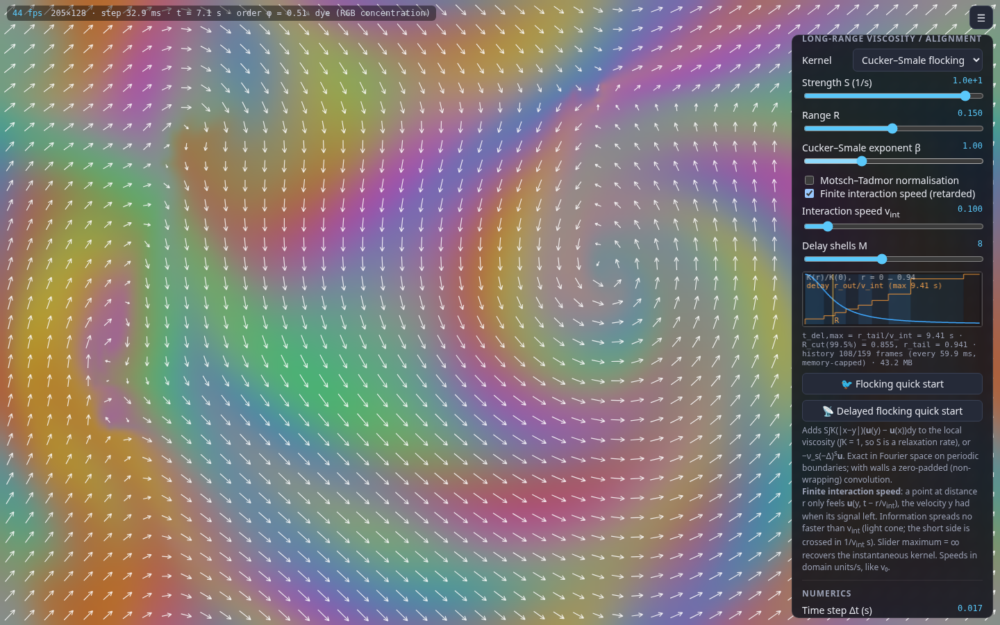

# Navier–Stokes 2D — interactive fluid simulator

A browser-based simulator for the **2D incompressible Navier–Stokes equations**
with a real-time visualization frontend. Drag with the mouse (or a finger) to
stir the fluid and inject coloured dye, and switch between views of the dye,
velocity, pressure, vorticity, and divergence fields. Boundaries can be solid
walls (no-slip or free-slip), fully **periodic**, or periodic in x with walls in
y (a channel). An optional **self-propulsion (active fluid)** term turns it
into a model of active turbulence, and long-range alignment kernels (optionally
with a **finite interaction speed**, i.e. retarded, time-delayed interaction)
turn it into a flock. A **calculation delay** (the point's own velocity is
delayed as well) makes the alignment over-correct, and the flow oscillates.

**Try it live: <https://csviragh.github.io/navier-stokes-sim/>**


Built with **Vite + TypeScript** and no UI framework. The physics solver is a
standalone, DOM-free module with unit tests, so you can extend it (other
solvers, 3D, GPU) without touching the UI.

## The equations

For a fluid with constant density ρ (we use ρ = 1), velocity **u**(x, t) and
pressure p(x, t):

```
∂u/∂t + (u·∇)u = −∇p/ρ + ν∇²u + f − (1/τ)(|u| − v₀) u/|u|    (momentum)
∇·u = 0                                                       (incompressibility / mass)
```

(the last momentum term is optional and off by default, see
[Self-propulsion](#self-propulsion-active-fluid) below)

- **Momentum:** a fluid parcel accelerates because of pressure differences,
  viscous friction (kinematic viscosity ν), and external forces **f** (your
  mouse).
- **Incompressibility:** the velocity field is divergence-free, so no fluid is
  created or destroyed anywhere. Pressure is not given by an equation of state.
  It is whatever field keeps ∇·u = 0, i.e. a Lagrange multiplier.

### Self-propulsion (active fluid)

With **Self-propulsion** switched on, the momentum equation gets the extra
force per unit mass

```
f_active = −(1/τ) (|u| − v₀) · u/|u|
```

- **τ** (relaxation time, s) sets how quickly the local speed adapts;
- **v₀** (target speed, domain units/s, the short side of the box is 1) is the
  speed the fluid "wants" to move at;
- **u/|u|** is the local unit vector of the flow, so the term only changes the
  *speed*, never the *direction*.

Where the fluid is slower than v₀ (|u| < v₀) the term accelerates it, and where
it is faster (|u| > v₀) it brakes it. This is the self-propulsion term of
Toner–Tu / Vicsek-type models of active matter (swimming bacteria, flocks).

The term was requested as `1/tau(v(x)-v_0)*(v(x,t)/v(x,t))`, which we read as
`(1/τ)(|v| − v₀) v/|v|`, i.e. the second `v(x,t)` is the magnitude |v| and
the fraction is the unit vector. Written on the right-hand side of the momentum
equation as a force it carries a **minus sign**; that minus is what makes it a
*relaxation* toward v₀ (with a plus sign speeds away from v₀ would grow
exponentially). If you prefer to read the user's expression as the term moved to
the left-hand side, `∂u/∂t + … + (1/τ)(|u| − v₀) u/|u| = …`, it is the same
equation.

**Numerics.** On its own the term gives d|u|/dt = −(|u| − v₀)/τ along a fixed
direction, which is solved exactly over each step:

```
|u|_new = v₀ + (|u| − v₀) · exp(−Δt/τ),     u_new = |u|_new · u/|u|
```

This is unconditionally stable for any Δt/τ and never overshoots v₀. On the
MAC grid |u| is evaluated at each face (the other component is interpolated
from the four neighbouring faces, as in advection). Where |u| < 10⁻⁶ the
direction is undefined and the face is left unchanged, so fluid at rest stays
at rest. Stir it, or use **Active turbulence quick start** (key `T`), which
seeds weak random swirls that the term then amplifies.

The step runs after advection and **before** the final projection, so the
field stays divergence-free. Because a uniform speed is generally not
compatible with ∇·u = 0 and the walls, |u| does **not** end up exactly v₀
everywhere. In a 64² box with v₀ = 0.5 and τ = 0.25 s the mean speed settles
at about 0.43 (≈ 87 % of v₀), with vortices and jets: active turbulence.

With **periodic** boundaries there are no walls to brake the flow. A uniform
flow is divergence free and periodic, so it is driven to |u| = v₀ *exactly*
(this is a unit test). Starting from random swirls on the torus (228 × 128,
v₀ = 0.5, τ = 0.5 s, ε = 2) the mean speed reaches ≈ 0.466 after 20 s (≈ 93 %
of v₀), versus ≈ 0.454 with no-slip walls and ≈ 0.459 in the periodic-x channel
under the same settings. The **Active
turbulence quick start** therefore switches the boundaries to periodic (you can
switch back at any time).


The dye is a passive scalar c (one per RGB channel) that is carried by the flow
and optionally diffuses (κ) and fades:

```
∂c/∂t + (u·∇)c = κ∇²c
```

### Long-range viscosity / alignment kernels

The local viscous term ν∇²u only couples neighbouring points. The
**Long-range viscosity / alignment** section adds an optional *nonlocal* term
**on top of** the local ν∇²u (the ν slider is unchanged; kernel *None* is the
default and leaves the solver bit-identical to before):

```
f_K(x) = S ∫ K(|x − y|) (u(y) − u(x)) dy          (convolution kernels, ∫K dA = 1)
f_s    = −ν_s (−Δ)^s u                            (fractional Laplacian, 0 < s ≤ 1)
```

| Kernel | K(r) before normalisation | Parameters |
|---|---|---|
| Gaussian | exp(−r²/(2R²)) | S, R |
| Cucker–Smale flocking | (1 + r²/R²)^(−β) | S, R, β (optional Motsch–Tadmor normalisation) |
| Power law | (r² + R²)^(−α/2) (R = softening length) | S, R, α |
| Fractional Laplacian | Fourier symbol ν_s λ(k)^s, λ = discrete −Δ symbol | ν_s, s |

**Normalisation.** Every convolution kernel is normalised so that ∫K dA = 1
(discretely Σ K h² = 1 over every offset that fits in the domain). S is then a
**rate** (1/s): each point relaxes toward its K-weighted neighbourhood average
velocity at rate S. For a Gaussian with small R, `S∫K(u(y) − u(x))dy ≈ S(R²/2)∇²u`,
so it is ordinary viscosity with ν_eff = S R²/2 (checked by a test). The
fractional strength ν_s has units L^{2s}/s, and s = 1 gives exactly the local
viscous decay rate νλ(k).

**Motsch–Tadmor** (checkbox): divide by the local kernel mass
c(x) = ∫_domain K(|x − y|) dy instead of ∫K = 1. With a uniform density, this
only makes a difference next to walls, where part of the kernel lies outside
the domain. On periodic grids it does nothing.

**How it is computed** (each velocity component on its own staggered sub-grid:
u on u-faces, v on v-faces, unknown faces only; the projection afterwards
restores ∇·u = 0). This is step 2b, right after local diffusion:

- *Fully periodic:* 2D FFT of exactly the grid size (radix-2 or Bluestein for
  any length), with minimum-image distances. The operator is diagonal:
  λ(k) = S(K̂(k) − K̂(0)) ≤ 0, applied **exactly** as û ← û·e^{λΔt}. The fractional
  term uses û ← û·e^{−ν_s λ(k)^s Δt}. Momentum is conserved exactly (λ(0) = 0) and
  kinetic energy can never increase.
- *Walls on at least one axis* (no-slip, free-slip, periodic-x channel): the
  walled axes are zero-padded to a power of two ≥ 2n − 1, so the convolution is
  **linear and never wraps across a wall**. The integral runs over the domain
  only: `f = S[(K*u)(x) − c(x)u(x)]` with c = K * 1_domain. Integration is
  semi-implicit, `u ← (u + SΔt (K*u)) / (1 + SΔt c)`: the convolution is
  explicit and the local part implicit. The result is a convex combination of
  old values, so it obeys a max principle and is stable for any Δt. Walls are
  not treated as zero-velocity neighbours; the kernel only aligns fluid with
  fluid.
- *Fractional on walled domains* is **not implemented**. It is inactive there,
  and the panel says so.

Kernel transforms are precomputed and cached. They are rebuilt only when the
kernel, R, β, α, s, boundaries, or grid change.

**With self-propulsion**, the kernel turns active turbulence into a
**flock**. Self-propulsion fixes the speed |u| ≈ v₀, and the alignment kernel
makes the directions agree over distance R. This is a continuum
Toner–Tu / Cucker–Smale-like active fluid. On a torus with Cucker–Smale
(S = 3/s, R = 0.05, β = 1), weak random swirls order into a global flow with
mean velocity ≈ v₀ within a few seconds. Try **🐦 Flocking quick start** (`F`).

References: F. Cucker & S. Smale, "Emergent behavior in flocks", *IEEE Trans.
Automatic Control* 52 (2007) 852–862; S. Motsch & E. Tadmor, "A new model for
self-organized dynamics and its flocking behavior", *J. Stat. Phys.* 144 (2011)
923–947; J. Toner & Y. Tu, *PRL* 75 (1995) 4326; M. Kwaśnicki, "Ten equivalent
definitions of the fractional Laplace operator", *Fract. Calc. Appl. Anal.* 20
(2017); and on alignment with nonlocal viscosity, E. Tadmor & C. Tan, *Phil.
Trans. R. Soc. A* 372 (2014).


### Finite interaction speed (retarded alignment)

With the kernel on, tick **Finite interaction speed (retarded)** (`D`) to let
the alignment signal travel at a finite speed v_int. A point at distance r then
feels the velocity the other point had when its signal left:

```
f_K(x, t) = S ∫ K(r) ( u(y, t − r/v_int) − u(x, t) ) dy,     r = |x − y|  (minimum image on periodic axes)
t_del(r)  = r / v_int
```

Only the received field K * u is retarded. The point's own velocity u(x, t) is
current. This is the retarded-potential construction of electrodynamics
(Jackson, *Classical Electrodynamics*, ch. 6) applied to velocity alignment. The
particle versions are the delayed Cucker–Smale models (refs below). v_int is in
domain units/s like v₀, so the short side of the domain is crossed in
1/v_int seconds. v_int → ∞ (slider maximum, "∞ (instant)") gives back the
instantaneous kernel. That setting, and the toggle being off, run exactly the
old code path, bit-identical to commit dc86501.

**Scheme.**

- *Shells.* The normalised kernel is split radially, K = K(0)δ + Σₘ Kₘ + K_tail.
  Kₘ (m = 0 … M−1, slider "Delay shells M", 2–16, default 8) are **equal-mass**
  shells r ∈ (rₘ, rₘ₊₁] inside R_cut, the radius that encloses 99.5 % of ∫K. The
  tail shell holds the remaining 0.5 % out to r_tail, beyond which less than 10⁻¹²
  of the mass lies. Equal mass puts narrow shells where a heavy-tailed kernel such
  as Cucker–Smale has most of its weight. The r = 0 term (a point's own velocity)
  is never delayed. Each shell uses the delay of its **outer** radius,
  τₘ = rₘ₊₁/v_int, so no part of the kernel ever gets information faster than
  v_int. The price is that delays are rounded up by at most one shell width. The
  shell spectra K̂ₘ are cached per kernel, grid, boundary, and M. Changing v_int
  or Δt needs no recomputation.
- *History.* A ring buffer holds past velocity fields (each component on its own
  staggered sub-grid) as they enter the kernel step, time-stamped with simulation
  time. On the torus it stores their **Fourier spectra**, so every frame is
  FFT'd once when stored. A step then costs one forward FFT, M + 1 complex
  multiply-adds, and one inverse FFT. With walls it stores real fields and
  transforms one delayed field per shell and step (zero-padded, non-wrapping
  convolution as before).
- *Time interpolation.* u(t − τₘ) is interpolated linearly between the two
  stored frames that bracket it. Before the history fills, missing delays use the
  oldest stored frame (or the current field). **Reset**, a boundary change, a grid
  change, or switching the delay off clears the history.
- *Update.* Semi-implicit, like the walled instantaneous kernel:

  ```
  w     = K(0) u(x, t) + Σₘ (Kₘ * u(·, t − τₘ))(x)
  u_new = (u + SΔt·w) / (1 + SΔt·c)          c = ∫K = 1 on the torus, c(x) = K * 1_domain with walls
  ```

  (Motsch–Tadmor uses a = SΔt/c as before.) u_new is a convex combination of
  present and past values, so the update obeys a max principle and is stable for
  any Δt, S, and v_int. On the torus the instantaneous kernel uses the exact
  Fourier exponential instead. A huge v_int therefore matches it to O((SΔt)²) per
  step, and matches an independent semi-implicit reference to 10⁻¹².
- *Memory cap.* The history keeps at most 32 MB per velocity component (≤ 512
  frames). If t_del,max = r_tail/v_int needs more frames than that, frames are
  recorded every t_del,max/(capacity − 2) seconds instead of every step, still
  interpolated linearly. The panel shows t_del,max, R_cut, r_tail, the number of
  frames stored and their spacing ("memory-capped" when coarser than Δt), and the
  memory used. The kernel plot shades the shells and draws the delay staircase.

**What holds.**

- *Causality (light cone).* An impulse at y is felt at distance r no earlier than
  r/v_int − Δt_hist (one history interval, from the linear interpolation in
  time), and no later than the delay of its shell plus one step. This is tested
  on periodic and walled grids. It holds for the alignment interaction only. The
  fluid is incompressible, so the pressure projection still acts instantly
  everywhere.
- *Momentum.* The retarded force is not reciprocal in time, so total momentum M
  is not conserved instantly after a kick. What is conserved is momentum plus the
  "in-flight" part, `M(t) + S Σₘ μₘ ∫_{t−τₘ}^{t} M(s) ds` (μₘ = shell mass). The
  scheme conserves its discrete analogue exactly. Once the history is stationary
  (M constant over t_del,max), M itself is conserved.
- *Uniform flow* stays uniform, since every delay sees the same value.

**What it does to a flock.** On a 205 × 128 torus with Cucker–Smale (S = 10/s,
R = 0.15, β = 1) plus self-propulsion, weak random swirls align into a global
flock (polar order φ = |⟨u⟩|/⟨|u|⟩ ≈ 1) after about 2 s when v_int = ∞. The times
grow to about 12 s with v_int = 0.2, about 25 s with v_int = 0.1, and more than
40 s with v_int = 0.05. Meanwhile large swirling domains persist, because each
region aligns with its neighbours long before it hears about the rest of the
flock. The retarded, still disordered velocities also act as a drag. The mean
speed stays near 0.3 v₀ until the flock has ordered, then slowly recovers to v₀.
In this model the delay did not destabilise the flock or cause sustained
oscillations in any run. That fits the linear analysis, because with a current
self term λ = −S + S K̂ e^{−λτ} has only stable roots for |K̂| < 1, and with
delayed Cucker–Smale consensus results (Pignotti & Trélat 2018). Oscillations
need the *reaction* itself to be delayed (the self term too), as in robot
flocks with sensor and actuation latency; that is the calculation delay below. **📡 Delayed flocking quick start**
(`L`) sets this up with v_int = 0.1, M = 8, periodic boundaries, no vorticity
confinement, and no dye fade. Watch the order parameter φ in the HUD.

References on delays in alignment / flocking: R. Erban, J. Haškovec & Y. Sun,
"A Cucker–Smale model with noise and delay", *SIAM J. Appl. Math.* 76 (2016)
1535–1557; C. Pignotti & E. Trélat, "Convergence to consensus of the general
finite-dimensional Cucker–Smale model with time-varying delays", *Commun. Math.
Sci.* 16 (2018) 2053–2076; C. Virágh et al., "Flocking algorithm for autonomous
flying robots", *Bioinspir. Biomim.* 9 (2014) 025012 (communication and sensor
delays in real robot flocks).



### Calculation delay and delay-induced oscillations

The delay has two components. The **interaction delay** r/v_int (above) is the
signal travel time. The **calculation delay** t_c is a constant processing time
(sensing, computing, actuating) that applies to the neighbours' velocities *and*
to the point's own velocity:

```
f(x, t) = S ∫ K(r) ( u(y, t − t_c − r/v_int) − u(x, t − t_c) ) dy
```

So a neighbour at distance r is seen t_c + r/v_int late, and the point's own
velocity t_c late. Set it with the **Calculation delay t_c** slider (0–2 s,
default 0 = off) in the *Delay* box of the kernel section. It works with or
without the finite interaction speed. With v_int = ∞ every shell has the same
delay t_c, so the term is a single convolution of u(t − t_c) and costs almost
nothing extra.

**Linear stability.** On the torus, linearised (no advection), each Fourier mode
k of each velocity component obeys

```
û_k'(t) = −S [ û_k(t − t_c) − K(0) û_k(t − t_c) − Σ_m K̂_m(k) û_k(t − t_c − r_m/v_int) ]
λ        = −S e^{−λ t_c} ( 1 − K(0) − Σ_m K̂_m(k) e^{−λ r_m/v_int} )           (characteristic equation)
```

where K(0) is the weight of the r = 0 offset and K̂_m the transform of shell m
(continuum: 1 − ∫K(r) e^{−ik·r} e^{−λ r/v_int} dr). With v_int = ∞ this is

```
λ = −a_k e^{−λ t_c},   a_k = S (1 − K̂(k)),   so   λ = W₀(−a_k t_c) / t_c   (Lambert W, principal branch = rightmost root)
```

the classic equation x' = −a x(t − τ) (Hayes 1950). Its regimes:

| a_k t_c | rightmost root | behaviour |
|---|---|---|
| < 1/e ≈ 0.368 | real, negative | monotone decay |
| 1/e … π/2 | complex, Re λ < 0 | damped oscillation |
| = π/2 | λ = ± i a_k | neutral oscillation, period 4 t_c |
| > π/2 | complex, Re λ > 0 | growing oscillation |

The uniform mode (k = 0, K̂ = 1) is never affected: the term vanishes for a
uniform flow. Since a_k → S for short waves (K̂ → 0), the flow as a whole starts
to oscillate once **S·t_c > π/2**. The panel shows S·t_c and the predicted regime
(`monotone`, `damped oscillation`, `unstable oscillation`). Local viscosity adds
an instantaneous damping b_k = νk², and then the threshold moves to
t_c* = arccos(−b/a)/√(a² − b²) (stable for every t_c if b ≥ a, again Hayes). With t_c = 0
the characteristic equation is λ = −S + S K̂ e^{−λτ}. The instantaneous damping S
then outweighs the delayed feedback |S K̂| ≤ S, so it is stable for every
interaction delay. That is why the interaction delay alone only slows flocking
down. With t_c > 0, the interaction delay adds lag on top and can tip a stable
t_c into instability (table below).

**Numerics vs. theory** (full solver, 64 × 64 torus (v_int = ∞ rows; 48 × 48 for the
finite-v_int rows), shear wave u_x = A sin(2π·4y),
which is an exact Navier–Stokes solution, so only the alignment term acts;
Cucker–Smale R = 0.15, S = 4, ν = 0; K̂ = 0.0075, a_k = 3.97, predicted onset
t_c* = π/(2a_k) = 0.396 s):

| t_c (s) | v_int | predicted λ (1/s) | simulated growth rate, ω |
|---|---|---|---|
| 0.35 | ∞ | −0.249 ± 4.324 i | −0.249, 4.323 |
| 0.39 | ∞ | −0.026 ± 4.011 i | −0.026, 4.011 |
| 0.40 | ∞ | +0.020 ± 3.939 i | +0.019, 3.939 |
| 0.42 | ∞ | +0.101 ± 3.803 i | +0.101, 3.803 |
| 0.45 | ∞ | +0.204 ± 3.616 i | +0.204, 3.616 |
| 0.38 | 0.1 | +0.091 ± 4.055 i (v_int = ∞: −0.075) | +0.090, 4.050 |
| 0.30 | 0.1 | −0.362 ± 4.480 i | −0.369, 4.481 |

The onset is where the theory puts it, to within the 0.01 s spacing tested. Above
it, the amplitude grows until the speed guard or self-propulsion stops it.

**What you see.** **〰️ Delay oscillations quick start** (`O`) uses Cucker–Smale
(R = 0.15, β = 1), S = 4/s, t_c = 0.42 s (S·t_c = 1.68 > π/2), v_int = ∞, weak
self-propulsion (τ = 2 s, v₀ = 0.3), periodic boundaries, no vorticity
confinement, and the vorticity view. It starts from weak random swirls
(|u| ≈ 0.05). The prediction for the short waves is λ = 0.10 ± 3.80 i, a period
of 1.65 s. The whole vortex pattern reverses its sense of rotation every half
period, and red and blue swap. The HUD trace (top left, last 20 s) plots the polar
order φ, the mean speed ⟨|u|⟩ and the **overlap** C(t) = ⟨u·u₀⟩/⟨u₀·u₀⟩ with
the flow at the quick start. C swings between about +1 and −1. In the browser
(219 × 128) the first zero crossings of C came at 0.43, 1.35, 2.23, 3.02, 3.77,
4.47, 5.10 s: a period of about 1.8 s at first, shortening to about 1.3 s as the
amplitude grows. That is close to the linear 1.65 s, but not equal, because the
flow is nonlinear and has many modes. Meanwhile ⟨|u|⟩ grows from 0.04 to about
0.43 within 8 s and then saturates near 0.4–0.55. Self-propulsion and advection
bound it, and the oscillation keeps going with a less regular pattern. Without
self-propulsion the growth continues until the speed guard caps it.


**Numerics of the delayed term.** The own velocity is in the past, so the update
can no longer be implicit in u. For t_c > 0 it is explicit, with the delayed
right-hand side taken at the step midpoint (second order in Δt):

```
u ← u + a ( w − c·u_d ),   a = S Δt  (Motsch–Tadmor: S Δt / c)
u_d = u(x, t + Δt/2 − t_c),   w = Σ_taps K_tap * u(·, t + Δt/2 − t_c − τ_tap)
```

Past fields come from the same history buffer (spectra on the torus, linearly
interpolated in time), which now covers t_c + r_tail/v_int (just t_c when
v_int = ∞). Lookups later than the current time use the current field, so
0 < t_c < Δt blends smoothly into explicit Euler. The memory cap (32 MB per
component, ≤ 512 frames) coarsens the frame spacing if needed. Reset, grid and
boundary changes, or turning both delays off clear the history. Until the
history covers the delay, the oldest frame is used. The explicit update needs
S·Δt ≲ 1 (the panel warns above 1). With t_c = 0 the old code path runs
unchanged, bit for bit (semi-implicit update, exact Fourier update when no delay
is on). A **speed guard** clamps each face velocity to ±10 after the delayed
update. It keeps a run-away instability finite, and in the quick start
self-propulsion saturates the growth long before the guard is reached.

References: N. D. Hayes, "Roots of the transcendental equation associated with a
certain difference-differential equation", *J. London Math. Soc.* 25 (1950)
226–232 (stability region of x' = a x + b x(t − τ)); R. Erban, J. Haškovec &
Y. Sun, *SIAM J. Appl. Math.* 76 (2016) 1535–1557; C. Pignotti & E. Trélat,
*Commun. Math. Sci.* 16 (2018) 2053–2076; C. Virágh et al., "Flocking algorithm
for autonomous flying robots", *Bioinspir. Biomim.* 9 (2014) 025012 (models
sensor and communication delays and the oscillations they cause in robot flocks).

## Numerical method

The solver follows Jos Stam's **Stable Fluids** (SIGGRAPH 1999; "Real-Time Fluid
Dynamics for Games", GDC 2003) with operator splitting. Each time step Δt runs:

1. **Forces.** User strokes blend the velocity under a Gaussian brush toward the
   pointer velocity. Optional **vorticity confinement** (Fedkiw, Stam & Jensen
   2001) adds `f = ε h (N × ω)` with `N = ∇|ω| / |∇|ω||` to restore small swirls
   that numerical dissipation removes.
2. **Viscous diffusion**, implicitly (backward Euler): `(I − νΔt∇²) u = u*`,
   solved with Gauss–Seidel. This is unconditionally stable. The sweep count
   adapts to how stiff the system is, capped by the *solver iterations* setting.
3. **Projection.** Solve the pressure Poisson equation `∇²p = (ρ/Δt) ∇·u*` with
   `∂p/∂n = 0` on the walls, using Gauss–Seidel with successive over-relaxation
   (SOR, ω = 1.7, warm-started from the previous step's pressure). With
   periodic boundaries it is solved directly with FFTs instead (see
   *Boundaries*). Then set
   `u = u* − (Δt/ρ) ∇p`. This is the Helmholtz–Hodge decomposition, which keeps
   only the divergence-free part.
4. **Self-advection**, semi-Lagrangian: trace each velocity sample backward
   through the flow (2nd-order Runge–Kutta), then **bilinearly interpolate** the
   old field there. Results are convex combinations of old values, so this step
   is unconditionally stable too.
5. **Self-propulsion** (optional): exact relaxation of the local speed toward v₀,
   `|u| ← v₀ + (|u| − v₀) e^(−Δt/τ)` along u/|u| (see above).
6. **Projection** again.

   (Step 2b, between local diffusion and the first projection, applies the
   optional long-range kernel; see above.)
7. **Dye:** implicit diffusion, semi-Lagrangian advection, and optional
   exponential fade.

**Grid.** The grid is a uniform staggered **MAC** grid. Pressure and dye sit at
cell centres, u on vertical faces, and v on horizontal faces. The discrete
divergence, gradient, and Laplacian are mutually consistent, so the projection
drives the discrete divergence to zero, up to solver tolerance. It also avoids
the checkerboard pressure modes of a collocated grid. The shorter side of the
domain has length 1. The default grid has **128 cells on the short side**, and
the long side follows the window's aspect ratio (e.g. 228 × 128 on a 16:9
window).

**Boundaries.** Choose them in the *Boundaries* menu (key `B` cycles):

| option | x edges | y edges |
|---|---|---|
| **No-slip walls** (default) | solid, u = 0 | solid, u = 0 |
| **Free-slip walls** | solid, no normal flow, tangential slides | same |
| **Periodic (torus)** | periodic | periodic |
| **Periodic in x, walls in y** | periodic | no-slip walls (endless channel) |

At solid walls the normal velocity is zero, and dye and pressure use zero-flux
(Neumann) conditions. On a **periodic** axis the domain wraps around:

- *Staggered faces.* The u-face at i = 0 and the one at i = nx are the same
  physical face. Face nx holds the unknown, and face 0 is kept as an exact copy,
  so nothing is counted twice. Likewise v at j = 0 ≡ j = ny. Ghost cells/rows hold
  wrapped copies of the opposite edge.
- *Viscosity and dye diffusion.* The 5-point Gauss–Seidel stencils read their
  neighbours across the seam directly from the opposite edge.
- *Pressure.* The Poisson equation uses the periodic Laplacian (every cell has
  4 neighbours along a periodic axis). It is singular (p is only defined up to a
  constant), so the mean of the right-hand side is removed (it is zero up to
  round-off, because the divergence telescopes) and the mean of p is pinned to 0.
  With a periodic axis the solve is **direct** and exact. An FFT along x
  diagonalises the Laplacian. For each x-wavenumber the remaining problem in y
  is a cyclic tridiagonal system on the torus (Thomas + Sherman–Morrison) or a
  Neumann tridiagonal system in the channel (Thomas). Bluestein's algorithm
  handles any grid width. So ∇·u is at round-off level after every projection,
  in every cell including the seam cells, and the *solver iterations* setting
  only affects the viscosity and dye-diffusion sweeps there. (A wrap-around SOR
  is kept as a reference. With a fixed sweep origin and only ~20 sweeps its
  residual piles up next to the seam, which is why it isn't the default.)
- *Gradient.* The pressure gradient is applied to the seam faces too.
- *Advection.* Semi-Lagrangian back-traces wrap around instead of being
  clamped, and the bilinear interpolation reads the wrapped ghosts. This applies
  to the velocity and the dye.
- *Self-propulsion, vorticity confinement, diagnostics.* Face-to-face
  interpolation, |ω| gradients, and the vorticity/divergence/arrow views use the
  wrapped neighbours. Mouse strokes near an edge continue on the opposite side.
- Switching the boundary at runtime makes the edge faces walls (zeroed) or seam
  unknowns as needed, and re-projects the velocity.

With periodic boundaries the total momentum can only change through your
strokes, since viscosity and projection conserve it to round-off. Semi-Lagrangian
advection is not exactly conservative, so a strongly stirred field slowly loses
a little (∝ amplitude²). A uniform flow and a uniform dye stay exactly uniform.

## Features

- Full-window Canvas2D rendering. The field is drawn at grid resolution and
  upscaled with bilinear smoothing.
- Mouse, touch, and pen input through Pointer Events, including multi-touch.
  Drag to inject velocity along the drag direction and to inject dye.
- **View modes:** dye, velocity magnitude (viridis), pressure, vorticity, and
  divergence. The last three use a diverging blue/white/red map with
  auto-scaling and an on-screen legend. A velocity-arrow overlay can be shown
  on top of any view.
- **Controls:** viscosity, dye diffusion, time step, solver iterations, grid
  resolution, vorticity strength, dye fade, boundaries (no-slip, free-slip,
  periodic, periodic-x channel), dye colour (or rainbow),
  brush radius, force strength, pause/play, single step, and reset.
- **Self-propulsion (active fluid)** section: on/off toggle (default off), τ
  (0.05–5 s, default 0.5 s), v₀ (0–2, default 0.5), and an *Active turbulence
  quick start* button that switches the term on, selects periodic boundaries,
  and seeds random weak flow.
- **Long-range viscosity / alignment** section: kernel (None, Gaussian,
  Cucker–Smale, power law, fractional; default None), strength (log slider,
  default S = 2/s), range R (0.005–0.3, default 0.05), β (default 1), α
  (default 3), s (default 0.5), Motsch–Tadmor checkbox, a live plot of K(r)
  (or of the fractional multiplier), and a *Flocking quick start* button that
  selects Cucker–Smale, self-propulsion, periodic boundaries, and turns off
  vorticity confinement.
- **Finite interaction speed** (in the same section): toggle (default off),
  v_int slider (log scale 0.05–20 domain units/s plus ∞ = instant, default 1),
  delay shells M (2–16, default 8), a live line with t_del,max, history frames
  and memory, the shells and delay staircase drawn in the kernel plot, and a
  *Delayed flocking quick start* button. These sit in a **Delay** box together
  with the **calculation delay** t_c (0–2 s, default 0), which shows S·t_c and
  the predicted regime and warns if S·Δt > 1. The kernel plot draws the total
  delay t_c + r_out/v_int, and the info line shows the total maximum delay. A
  *Delay oscillations quick start* button (`O`) sits with the other quick starts.
- **HUD time trace** (top left): φ, ⟨|u|⟩ and the overlap with the flow at the
  last reset / quick start, over the last 20 s of simulated time.
- FPS, grid size, solver time per step, and (with a kernel or self-propulsion)
  the polar order parameter φ are shown in the HUD. A short
  explanation of the equations is built into the panel.
- **Keyboard:** `Space` pause, `S` step, `R` reset, `V` cycle view, `A` toggle
  arrows, `B` cycle boundaries, `P` toggle self-propulsion, `T`
  active-turbulence quick start, `K` cycle kernel, `F` flocking quick start,
  `D` toggle finite interaction speed, `L` delayed-flocking quick start,
  `O` delay-oscillations quick start, `H` hide the panel.


## Getting started

Requires Node.js ≥ 20.19 (CI uses Node 22).

```bash
npm install
npm run dev       # start the dev server (http://localhost:5173)
npm test          # run the solver unit tests (Vitest)
npm run build     # type-check and build static files into dist/
npm run preview   # serve the production build locally
```

## Project structure

```
src/
  solver/            # pure numerics, no DOM: unit-testable and portable
    grid.ts          #   MAC grid layout, indexing, field allocation,
                     #   boundary types (walls / periodic / periodic-x)
    ops.ts           #   kernels: boundaries, interpolation, diffusion,
                     #   advection, projection, vorticity confinement,
                     #   self-propulsion (active fluid)
    poisson.ts       #   direct periodic pressure solver (FFT + tridiagonal)
    fft.ts           #   radix-2 / Bluestein FFT for any length
    kernels.ts       #   nonlocal viscosity / alignment kernels (spectral),
                     #   retarded shells + delay history (finite v_int),
                     #   calculation delay (explicit delayed update)
    fluid.ts         #   FluidSolver: state + time stepping, splat/stir input
    index.ts
  render/
    colormaps.ts     # viridis / diverging lookup tables, colour helpers
    renderer.ts      # Canvas2D field rendering + velocity-arrow overlay
  ui/
    settings.ts      # user settings and defaults
    controls.ts      # binds the HTML control panel and keyboard shortcuts
    pointer.ts       # mouse / touch / pen input via Pointer Events
  main.ts            # wiring + animation loop
  style.css
tests/
  solver.test.ts     # Vitest unit tests for the solver
  selfprop.test.ts   # tests for the self-propulsion term
  periodic.test.ts   # tests for the periodic boundaries
  kernels.test.ts    # tests for the long-range viscosity / alignment kernels
  delay.test.ts      # tests for the finite interaction speed (retarded kernels)
  calcdelay.test.ts  # tests for the calculation delay (stability thresholds)
  lambert.ts         # Lambert W₀ for the delay characteristic equation
  fingerprint.ts     # bit-exact fingerprints of scripted runs
index.html           # page layout, control panel, equations panel
.github/workflows/
  ci.yml             # tests + build on push / PR
  deploy-pages.yml   # GitHub Pages deployment (on push to main)
```

The solver is plain TypeScript on `Float32Array`s. You can use it on its own:

```ts
import { FluidSolver } from './src/solver';

const sim = new FluidSolver(128, 128, { viscosity: 1e-4, iterations: 30 });
sim.splat(64, 32, 0, 2, [1, 0.5, 0.2], 6); // velocity impulse + dye
for (let n = 0; n < 100; n++) sim.step();
sim.updateDiagnostics(); // fills uc, vc, divergence, vorticity
```

## Tests

`tests/solver.test.ts` checks, among other things, that:

- projection reduces the RMS divergence by more than 1000× and leaves an
  already divergence-free field unchanged;
- dye mass is roughly conserved under advection in a closed box (within 10%
  after 120 steps; semi-Lagrangian advection is not exactly conservative), and
  conserved to within 1% under pure diffusion;
- uniform-velocity advection translates a field exactly and interpolates
  bilinearly;
- 500 steps of strong random forcing with vorticity confinement produce no
  NaNs and stay bounded;
- a zero field stays exactly zero;
- walls don't leak dye, viscosity dissipates energy, and the stir, reset, and
  resample helpers behave correctly.

`tests/kernels.test.ts` checks the nonlocal kernels. On periodic grids every
kernel conserves momentum, never increases energy, and leaves uniform flow
unchanged. A single Fourier mode decays at exactly S(K̂(0) − K̂(k)) for Gaussian
and Cucker–Smale, and the Gaussian matches its analytic transform. A small-R
Gaussian matches ν_eff = S R²/2. Fractional s = 1 reproduces the local viscous
rate, and s < 1 flattens the spectrum. The walled convolution doesn't wrap
across walls and obeys a max principle. Long runs with kernels, self-propulsion,
and stirring stay finite on all boundary types. With kernel None, all four
boundary types are bit-identical to commit 22fd8ba.

`tests/delay.test.ts` checks the finite interaction speed. With the toggle
off, or with v_int = ∞, eight kernel and boundary scenarios are bit-identical
to commit dc86501. The shells partition the kernel exactly
(K(0)δ + Σ Kₘ = K in real space, and to 10⁻¹² in Fourier space), their masses
sum to 1, and every offset gets a delay of at least r/v_int (except the ultra-tail beyond r_tail, < 10⁻¹² of the mass). A huge v_int
reproduces the walled instantaneous kernel to 10⁻¹³, and on the torus an
independent semi-implicit reference to 10⁻¹² (the exact exponential to
O((SΔt)²)). A uniform flow stays uniform. The light-cone test checks that an
impulse is not felt at distance r before r/v_int − Δt and is felt by the delay
of its shell plus one step (torus and walls). Momentum is conserved for a
stationary history, and the discrete "momentum + in-flight momentum"
invariant holds exactly after a kick. Runs with tiny v_int, large Δt, strong S,
self-propulsion, and stirring stay finite on all boundaries. The memory cap
coarsens the history instead of growing it. Reset, boundary changes, and
switching the delay off clear the history, and start-up uses the current
field.

`tests/calcdelay.test.ts` checks the calculation delay. With t_c = 0, every
kernel/boundary scenario is bit-identical to commit 6a8ab36, both instantaneous
and with finite v_int (v_int = 0.3, M = 8 and v_int = 0.05, M = 3). A single
Fourier mode with v_int = ∞ decays monotonically for a t_c = 0.25, shows a damped
oscillation for 1.0, and grows for 1.8. Its rate and frequency match
W₀(−a t_c)/t_c within 3 % and 1 %. The full-solver shear wave changes from decay
to growth around a_k t_c = π/2 (t_c = 0.38 decays, 0.41 grows), and the combined
characteristic equation with finite v_int is matched too. The single-tap path
(v_int = ∞) agrees with the shell path at huge v_int. A uniform flow is
unchanged. An impulse is felt at distance r no earlier than t_c + r/v_int − Δt,
and the point's own response comes after t_c. Momentum on the torus is
conserved. In the oscillation regime with self-propulsion the instability
grows (sign changes in the overlap, period ≈ 1.65 s, mean speed ×3) but stays
bounded, and strongly unstable runs on all boundaries stay finite. t_c between
0 and Δt varies the result continuously. The history covers t_c + r_tail/v_int.
Reset, boundary changes and t_c → 0 clear it, and runs are reproducible.

`tests/selfprop.test.ts` checks the self-propulsion term:

- a uniform flow relaxes toward v₀ from below and from above, matching
  `v₀ + (|u|₀ − v₀) e^(−t/τ)`, and an oblique flow keeps its direction;
- the update is exact without overshoot even for Δt ≫ τ;
- a zero field stays exactly zero (no NaNs from u/|u|);
- 500 steps with the term on plus random stirring stay finite and bounded;
- weak random flow is driven up to an rms speed near v₀ while staying
  divergence-free;
- with the term off, results are bit-identical whatever τ and v₀ are.

`tests/periodic.test.ts` checks the periodic boundaries:

- ghost layers wrap and the seam faces coincide; the channel keeps v = 0 and
  mirrors u at its walls;
- a uniform flow stays exactly uniform (all operators on), and an inviscid plug
  flow persists in the periodic channel;
- a sine shear wave and a Taylor–Green vortex decay at the analytic rates
  exp(−νk²t) and exp(−2νk²t), within 1 %;
- projection and viscosity conserve total momentum to round-off, and a full
  stirred run keeps it within 5 %;
- a uniform dye stays exactly uniform, the dye-mass drift stays bounded, and a
  blob advected through the right edge re-enters on the left, mass conserved;
- the FFT matches a naive DFT (power-of-two and Bluestein lengths), and the
  direct periodic pressure solve agrees with a fully converged wrap-around SOR;
- projection leaves ∇·u ≈ 0 (≤ 10⁻⁵ of the initial value) in every cell,
  including the seam cells, on the torus and in the channel;
- a state shifted across the seam evolves into the shifted result (translation
  invariance, so there are no seam artefacts);
- with self-propulsion a uniform flow reaches |u| = v₀ exactly (walled: < 95 %),
  and active turbulence on the torus settles near v₀;
- stirring across the edges for 400 steps gives no NaNs; switching boundaries
  at runtime re-projects; strokes at an edge wrap;
- the no-slip and free-slip runs are **bit-identical** to the version before
  periodic boundaries were added (hash of a scripted run, `tests/fingerprint.ts`).

## Deploying to GitHub Pages

`.github/workflows/deploy-pages.yml` builds the app and publishes `dist/` to
GitHub Pages on every push to `main` (it can also be run manually). The live
site is <https://csviragh.github.io/navier-stokes-sim/>.
Vite is configured with `base: './'`, so the build works under
`https://<user>.github.io/navier-stokes-sim/` with no changes.

## Limitations

- The solver runs on the CPU in a single JS thread. On the slow, shared
  server-class CPU used for development, a step at 228 × 128 took about 24 ms
  (~30 fps in headless Chrome). Typical desktop CPUs are several times faster.
  If the frame rate drops, lower the grid resolution or the solver iterations.
- Semi-Lagrangian advection is numerically diffusive and not exactly
  mass-conserving. Fine detail smears out over time. Vorticity confinement
  partly compensates for this.
- Gauss–Seidel/SOR converges slowly for large grids. With few iterations a
  small residual divergence remains (visible in the *divergence* view).
- Long-range kernels cost roughly 15 ms per step at 219 × 128 on the slow
  development CPU (about 32 ms per step in total on a torus, 44 ms with
  no-slip walls). The FFTs run on the CPU.
- The fractional Laplacian only works on fully periodic boundaries.
- Finite interaction speed: on a torus it adds only about 2–3 ms per step
  (205 × 128: 32 → 34 ms), because past spectra are stored. With walls it costs
  one padded FFT per shell, about 3× the instantaneous kernel (42 → 124 ms per
  step at M = 8). Use fewer shells there. The history can use up to 64 MB
  (2 × 32 MB). Delays are rounded up to the shell's outer radius, and the time
  interpolation can make a signal arrive up to one history interval early. The
  fractional Laplacian has no real-space kernel, so it ignores the delay. The
  light cone applies to the alignment term only, because the incompressibility
  projection is instantaneous.
- Calculation delay: the update is explicit, so keep S·Δt ≲ 1 (the panel
  warns). The linear analysis ignores advection and self-propulsion. In a moving
  flow the delayed term reads the velocity at a fixed point in space, so a mode
  with k·U ≠ 0 picks up a phase k·U·t_c and its threshold shifts. Expect the
  thresholds to hold for the onset from weak flow, not exactly in a fast,
  developed flow. The speed guard (±10 per face component) is a safety net, not
  physics. Cost: about 0.7 ms per step extra on a 219 × 128 torus with v_int = ∞
  (39.8 → 40.5 ms on the dev CPU in Node), and 4 ms extra combined with
  v_int = 0.3 (43.8 ms). With no-slip walls it costs 50 ms with t_c only and
  61 ms combined, versus 46 ms instantaneous.
- Vorticity confinement amplifies grid-scale noise in a strongly ordered
  (flocking) flow, so the flocking quick start switches it off.
- Vorticity confinement is integrated explicitly, so εΔt is clamped to 0.2 for
  stability.

## Ideas for next steps

- **GPU solver** (WebGL2 fragment shaders or WebGPU compute) using Jacobi or
  red-black Gauss–Seidel. This would allow 512²+ grids at 60 fps.
- **Multigrid** or **preconditioned conjugate gradient** pressure solver for
  faster, more accurate projection.
- Higher-order / less diffusive advection: **MacCormack / BFECC**, or a
  **FLIP/PIC** particle-grid hybrid.
- **Obstacles** you can draw (internal solid boundaries), and **inflow/outflow**
  boundaries (wind tunnel, flow past a cylinder with a Kármán vortex street).
- **Buoyancy** (Boussinesq: temperature/smoke rising) and variable density.
- Validation cases: lid-driven cavity vs. Ghia et al., Poiseuille flow in the
  periodic channel with a body force (decaying Taylor–Green is already a test).
- Particle tracers and streamlines; LIC (line-integral convolution) view.
- **3D** solver (the grid/ops separation is designed to make this a parallel
  module) with volume rendering.
- Move the solver into a Web Worker to keep the UI thread free.
